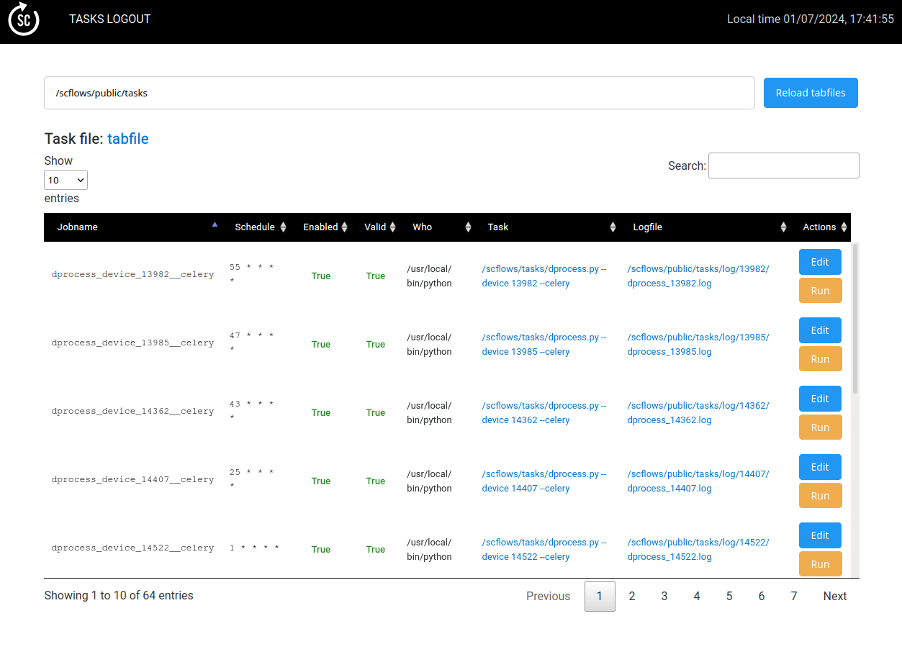

# Smart Citizen Flows

Flows is the ata processing toolset for the [Smart Citizen](https://smartcitizen.me) platform. It processes and backs up the data of the devices of the Smart Citizen API, with [scdata](https://github.com/fablabbcn/smartcitizen-data) and [smartcitizen-connector](https://github.com/fablabbcn/smartcitizen-connector), and manages the processing metadata. It is a [flask](https://flask.palletsprojects.com) application with [celery](https://docs.celeryq.dev) workers.



## Processing

A device is processed when its postprocessing in the Smart Citizen API has a `hardware_url`. Each unit has processing blueprint attached including:

| Blueprint | Job | Description |
|---|---|---|
| `process` | `process`, every 3 hours | Processes the latest readings (up to 1000) and posts the results to the Smart Citizen API |
| `long` | `long`, weekly (`meta.every_days`) | Backs the device up, processes the last `meta.window_days` (90 by default) of its backups with algorithms that need months of data (baselines), and stores the results in S3. Nothing is posted |
| `backup` | `backup`, every 6 hours | Backs the data up to S3, in periods of 20 days |

Every run also runs the health checks of its blueprint (gaps, implausible, flat and outlier values).

## Web interface

Users sign in with their Smart Citizen account to a web interface and check the status of their devices.

## API

Under `/api/v1/`. Metadata is public, but writing requires an admin Smart Citizen API token.

| Endpoint | Content |
|---|---|
| `GET /blueprints`, `GET /blueprints/<name>[.json]` | Blueprints: the list (name, kind, url) and each one |
| `GET /hardware`, `GET /hardware/<name>[.json]` | Hardware: the same object in the list and by name (see below) |
| `GET /calibrations[?kind=alphasense_sensor\|afe_board]`, `GET /calibrations/<sensor_id>` | Calibrations of Alphasense sensors and AFE boards |
| `GET /names`, `GET /names/<name>` | Names that scdata and the blueprints give each Smart Citizen sensor id |
| `GET /parameters`, `GET /parameters/<type>` | Parameter sets of long processing |
| `PUT`, `DELETE /<blueprints\|hardware\|calibrations\|names\|parameters>/<name>` | Create, replace or delete (admin) |
| `GET /<kind>/<name>/revisions` | History of changes |
| `POST /hardware/<name>/check` | Checks a hardware without saving it |
| `GET /devices/health`, `GET /devices/<id>/health` | Health of the devices (admins, or researchers for their devices) |
| `GET /devices/<id>/series` | Results of long processing (`?channels=`, `?from=`, `?to=`, `?resample=1h`, `?format=csv`) |
| `GET /jobs`, `GET /runs/<id>`, `POST /jobs/sync` | Jobs and runs (admin) |

## Development

Run everything with docker (`postgres`, `redis`, `web`, `celery`, `beat`, `flower`, and `proxy`, the only service with ports):

```
docker compose up -d --build
docker compose exec web flask --app scflows metadata import <smartcitizen-data checkout>
docker compose exec web flask --app scflows jobs sync
```

Jobs can be run by hand, also as dry runs, which neither post nor store the processed results (a long run still backs the device up first):

```
flask --app scflows jobs list [--task process|backup|long]
flask --app scflows jobs run <device> process --dry-run [--inline]
flask --app scflows jobs run <device> long --dry-run --inline
```

See [docs/deploy.md](docs/deploy.md) to deploy, update and back up the server.
