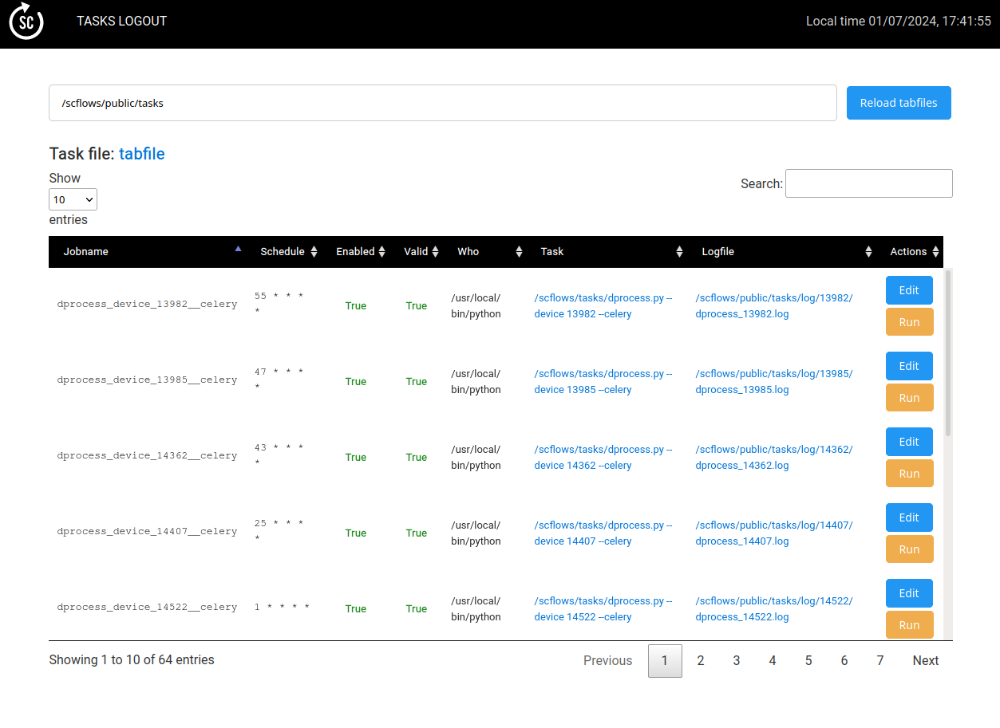

# Smart Citizen Flows

Data processing for the [Smart Citizen](https://smartcitizen.me) platform. Flows processes and backs up the data of the devices of the Smart Citizen API, with [scdata](https://github.com/fablabbcn/smartcitizen-data) and [smartcitizen-connector](https://github.com/fablabbcn/smartcitizen-connector), and manages the processing metadata: hardware, blueprints, calibrations and sensor names. It is a [flask](https://flask.palletsprojects.com) application with [celery](https://docs.celeryq.dev) workers.



## How devices are processed

A device is processed when its postprocessing in the Smart Citizen API has a `hardware_url` that names a hardware in flows (`SCAS210022`, or a url ending in `hardware/SCAS210022.json`). The hardware lists its blueprints by name, at most one of each kind (`meta.kind` of the blueprint, `process` when missing):

| Kind | Job | What it does |
|---|---|---|
| `process` | `process`, every 3 hours | Processes the latest readings (up to 1000) and posts the results to the Smart Citizen API |
| `long` | `long`, weekly (`meta.every_days`) | Backs the device up, processes the last `meta.window_days` (90 by default) of its backups with algorithms that need months of data (baselines), and stores the results in S3. Nothing is posted |
| `backup` | `backup`, every 6 hours | Backs the data up to S3, in periods of 20 days |

A hardware has a `process` blueprint, a `long` one, or both, and can add a `backup` one when it has no `long` one (long processing already backs up), or only have a `backup` one. Devices are only processed with the blueprints of their hardware: the `blueprint_url` of their postprocessing is not used.

`celery beat` queues the jobs that are due every minute, and syncs the jobs with the Smart Citizen API every hour, so devices get or lose jobs as their hardware changes. A job never runs twice at the same time for a device. Each run keeps its log, its result and what it used (hardware, blueprint, period, channels).

Every run also runs the health checks of its blueprint (gaps, implausible, flat and outlier values), and keeps the result for 30 days: `ok`, `warning`, or `problem` when 20% or more of the readings are flagged.

The parameters of long processing (e.g. of the baselines) can be tuned per sensor type (parameter sets) and per hardware (`parameters`: `{channel: kwargs}`), which can also switch the function of a channel (`{"O3": {"function": "alphasense_803_04"}}`).

## Web interface

Users sign in with their Smart Citizen account.

- `/jobs/`: jobs and runs, per device. Admins run, pause and resume them, and sync them with the Smart Citizen API.
- `/health/`: health of each device, and results of long processing. Admins see every device, researchers the ones they own.
- `/metadata/`: hardware, blueprints, calibrations, parameter sets and sensor names, with their history. Admins edit them, researchers see the hardware of their devices. Hardware can have files attached (certificates, calibration reports), which are not public.

## API

Under `/api/v1/` (`GET /api/v1/` lists the endpoints). Reading the metadata is public, since processing reads it without a token. Writing requires the Smart Citizen API token of an admin (`Authorization: Bearer <token>`).

| Endpoint | Content |
|---|---|
| `GET /blueprints`, `GET /blueprints/<name>[.json]` | Blueprints: the list (name, kind, url) and each one |
| `GET /hardware`, `GET /hardware/<name>[.json]` | Hardware: the same object in the list and by name (see below) |
| `GET /calibrations[?kind=alphasense_sensor\|afe_board]`, `GET /calibrations/<sensor_id>` | Calibrations of Alphasense sensors and AFE boards |
| `GET /names`, `GET /names/<name>` | Names that scdata and the blueprints give each Smart Citizen sensor id |
| `GET /parameters`, `GET /parameters/<type>` | Parameter sets of long processing |
| `PUT`, `DELETE /<blueprints\|hardware\|calibrations\|names\|parameters>/<name>` | Create, replace or delete (admin) |
| `GET /<kind>/<name>/revisions` | History of changes |
| `POST /hardware/<name>/check` | Checks a hardware without saving it |
| `GET /devices/health`, `GET /devices/<id>/health` | Health of the devices (admins, or researchers for their devices) |
| `GET /devices/<id>/series` | Results of long processing (`?channels=`, `?from=`, `?to=`, `?resample=1h`, `?format=csv`) |
| `GET /jobs`, `GET /runs/<id>`, `POST /jobs/sync` | Jobs and runs (admin) |

A hardware is served with the same object in the list and by name: `name`, `blueprints`, `description`, `comment`, `forwarding`, `parameters`, `versions` (the sensors mounted in each period) and `url`. It can be sent back as served, and it is checked before it is saved: errors reject it, warnings are returned with it. See the [data processing guide](https://docs.smartcitizen.me/guides/data/custom-data-processing/#hardware) for its fields.

The metadata used to be json files in [smartcitizen-data](https://github.com/fablabbcn/smartcitizen-data), which can still be imported and compared:

```
flask --app scflows metadata import <smartcitizen-data checkout> [--overwrite]
flask --app scflows metadata verify <smartcitizen-data checkout or url>
```

New sensors of the firmware and of the Smart Citizen API are added to the sensor names with `flask --app scflows names sync`.

## Development

```
pip install -e ".[dev]"
cp env.example .env     # and fill it in
pytest
```

Run the app (`flask run`), the workers and the schedule:

```
celery --app scflows.worker:app worker -l info
celery --app scflows.worker:app beat -l info   # only one instance
```

Or everything with docker (`postgres`, `redis`, `web`, `celery`, `beat`, `flower`, and `proxy`, the only service with ports):

```
docker compose up -d --build
docker compose exec web flask --app scflows metadata import <smartcitizen-data checkout>
docker compose exec web flask --app scflows jobs sync
```

Jobs can be run by hand, also as dry runs, which neither post nor store the processed results (a long run still backs the device up first):

```
flask --app scflows jobs list [--task process|backup|long]
flask --app scflows jobs run <device> process --dry-run [--inline]
flask --app scflows jobs run <device> long --dry-run --inline
```

See [docs/deploy.md](docs/deploy.md) to deploy, update and back up the server.
